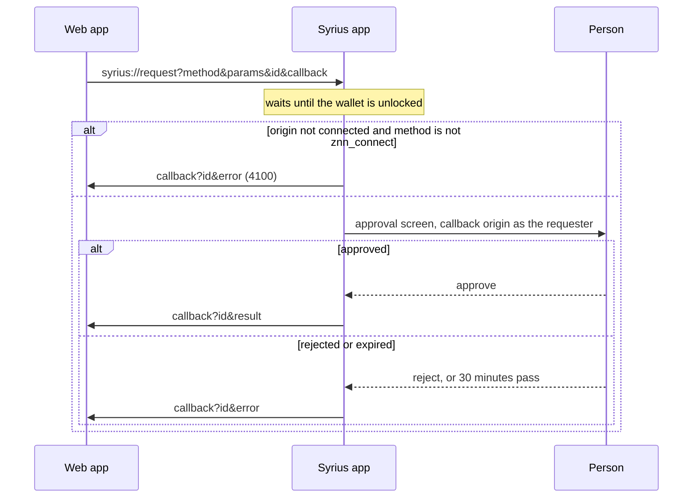

# Requests from another app

On Android there is no `window.zenon`: a web page in the phone's browser, or
another app, asks the Syrius app for a connection or a signature with a
`syrius://request` link, and the app answers by opening a callback URL the
request named. The approval is the extension's own, unchanged: the same
screens, the same per-account consent, the same limits
([Integrating a site](INTEGRATION.md)). Only the transport differs.



The callback is opened once, by Android, as any link is: an https callback
opens in the browser (or in the app that verified that domain), an app scheme
opens the app that registered it.

## The request

```
syrius://request?method=<method>&params=<params>&id=<id>&callback=<url>
```

| Field | |
|---|---|
| `method` | One of the methods below. Anything else and the link is ignored. |
| `params` | JSON, or base64url of the JSON (no padding). Base64url is the form that survives every app's link handling; use it. Omit for methods without params. |
| `id` | Your correlation ID, up to 128 characters, returned as is. Missing or longer, the app makes one up (`syrius-<ms>`), so always send one. |
| `callback` | Where the answer goes. Its origin is the requester's identity (below). |

A link that does not parse (unknown method, unusable callback, params that
are not JSON) is dropped **without any answer**, because there is nowhere
safe to send one. Time out on your side.

The link should come from a tap. Chrome for Android does not open another
app from a navigation the page started on its own.

## The callback, and who is asking

The requester is the callback's origin. It is what the approval screen shows,
what consent is stored under, and what `znn_connect` connects.

| Callback | Requester | |
|---|---|---|
| `https://app.example/zenon/return` | `https://app.example` | Recommended |
| `myapp://return` | `myapp://return` | An app's own scheme: `scheme://host` |
| `http://192.168.1.20:8787/` | `http://192.168.1.20:8787` | Private hosts only (below) |

http is accepted only for a private host: `localhost`, `*.localhost`,
`*.local`, `[::1]`, 127/8, 10/8, 172.16/12 and 192.168/16. On the open
internet anyone on the path could read the answer. Refused outright:
`javascript:`, `data:`, `file:`, `content:`, `intent:`, `blob:`, `about:`,
`syrius:`, `ws:`, `wss:`, `ftp:`, `chrome:`, `chrome-extension:`.

Nothing proves the link came from the callback's owner. That is safe because
the answer only ever goes to the callback: a page that names your callback
gets your answer delivered to you, not to itself. It is also why an https
callback is the one to use. Any Android app can register any custom scheme,
and when two do, which one receives the answer is up to Android and the
person. A domain verified as an Android App Link has one owner.

## The answer

The callback is opened with `id` and either `result` or `error` added to its
query (an existing parameter of the same name is replaced; everything else in
the callback, fragment included, is kept). Both values are base64url JSON.

```
https://app.example/zenon/return?id=42&result=WyJ6MXF6Li4uIl0
https://app.example/zenon/return?id=43&error=eyJjb2RlIjo0MDAxLCJtZXNzYWdlIjoiLi4uIn0
```

`error` decodes to `{ "code": <number>, "message": <string> }`.

## Methods

| Method | `params` | `result` |
|---|---|---|
| `znn_connect` | none | `["z1q…"]`. Answered at once for an origin already connected. |
| `znn_sendTransaction` | `{ "to", "tokenStandard", "amount" }`, `amount` a string in the token's smallest unit | `{ "hash", "block" }` |
| `znn_signAndSendBlock` | An account block, as `zenon.sendAccountBlock` takes it | `{ "hash", "block" }` |
| `znn_sign` | `{ "message" }` | `{ "message", "address", "publicKey", "signature" }`, hex, [verified as in the extension](INTEGRATION.md#verifying-a-signature) |
| `znn_accounts` | none | `[]`, or `["z1q…"]` once connected. No prompt. |
| `znn_chainId` | none | `null` until connected, then the chain ID. No prompt. |
| `znn_nodeUrl` | none | `null` until connected, then `ws(s)://host[:port]`. No prompt. |

Every send and signature is shown and answered by the person; nothing is
signed from a link alone. Connect first: any other request from an origin
that is not connected is refused with 4100 before a prompt is shown.

## Errors

The codes are the extension's ([Integrating a site](INTEGRATION.md)):

| Code | |
|---|---|
| `4001` | The person declined. |
| `4100` | This origin is not connected. Send `znn_connect`. |
| `4900` | The wallet did not accept or did not finish the request. When the message says so, the outcome is unknown: look the block up before asking again. |
| `-32602` | Malformed params. |
| `-32005` | Too many requests waiting; try later. |
| `-32006` | Expired before anyone answered. |
| `-32603` | Approved after its deadline: the outcome is unknown, check before retrying. |

## Timing

A request waits until the wallet is unlocked, and while an approval is on
screen, the next one waits for it. The app keeps the four most recent links
that arrive while it waits and drops older ones: a burst of links is one
person tapping, not a queue. An approval expires 30 minutes after it is
admitted; a minute past that, the app answers 4900 itself if nothing else
has.

## Example

```js
const b64url = (value) => btoa(String.fromCharCode(...new TextEncoder().encode(JSON.stringify(value))))
  .replace(/\+/g, '-').replace(/\//g, '_').replace(/=+$/, '');
const unb64url = (text) => JSON.parse(new TextDecoder().decode(
  Uint8Array.from(atob(text.replace(/-/g, '+').replace(/_/g, '/')), (c) => c.charCodeAt(0))));

// Asking: put it behind something the person taps.
const link = (method, params) => {
  const id = crypto.randomUUID();
  sessionStorage.setItem('syrius.pending', id);
  const query = new URLSearchParams({ method, id, callback: `${location.origin}/zenon/return` });
  if (params) query.set('params', b64url(params));
  return `syrius://request?${query}`;
};
sendButton.href = link('znn_sendTransaction', {
  to: 'z1q…',
  tokenStandard: 'zts1znnxxxxxxxxxxxxx9z4ulx',
  amount: '100000000', // 1 ZNN
});

// On /zenon/return: match the id, then read the answer.
const query = new URLSearchParams(location.search);
if (query.get('id') === sessionStorage.getItem('syrius.pending')) {
  if (query.has('error')) {
    const { code, message } = unb64url(query.get('error'));
  } else {
    const { hash } = unb64url(query.get('result'));
  }
}
```

`node tools/app-links/serve.mjs` serves a page that builds these requests and
decodes the answers, to try from a phone on the same network
([tools/app-links](../tools/app-links/README.md)). The parsing is
`src/platform/linkRoutes.js`; the answer is `src/platform/appRequests.js`.

## Screen links

Desktop Syrius's links open a screen with its form filled in and send
nothing:

| Link | Opens |
|---|---|
| `syrius://transfer?address=z1…&amount=1.5&zts=znn` | Send |
| `syrius://stake?amount=100&duration=3` | Stake, duration in months |
| `syrius://delegate?pillar=Name` | Delegate, after asking |
| `syrius://fuse?address=z1…&amount=10` | Plasma |
| `syrius://sign-message?message=…` | Sign message |
| `syrius://receive`, `tokens`, `plasma`, `az`, `rewards`, `settings`, `sentinel`, `pillar`, `home` | That screen |

Arguments other than these are dropped, and each is at most 256 characters
(`message` 8,192).
