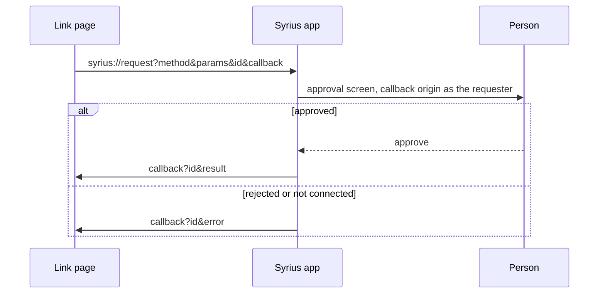

# syrius:// link page

A page to tap every `syrius://` link the Android app handles, from the phone's
own browser, and to read what the app answers to a `syrius://request`.

```
node tools/app-links/serve.mjs            # prints http://<LAN address>:8787/
```

Open a printed address on the phone (same Wi-Fi as this machine; Windows may
ask to let Node through the firewall the first time).

- **Screens**: one link per action in `src/platform/linkRoutes.js`, built from
  the fields above them. The app opens the screen with the form filled in and
  sends nothing.
- **Request**: a method, its params as JSON, and the callback, which is this
  page. Open in Syrius, approve or reject in the app, and the app opens the
  callback with `id` and `result` or `error`; the page decodes it under
  Answers and keeps the last twenty.

A request from an app that has not connected is refused with 4100 before any
prompt, so send `znn_connect` first. The request and answer formats are in
[docs/APP-REQUESTS.md](../../docs/APP-REQUESTS.md).

The callback is plain http. The app accepts that only for private addresses
(localhost, 127/8, 10/8, 172.16/12, 192.168/16, `*.local`); anywhere else a
callback must be https or an app's own scheme.



The screen list is copied by hand from `linkRoutes.js`; add a link here when
an action is added there.
